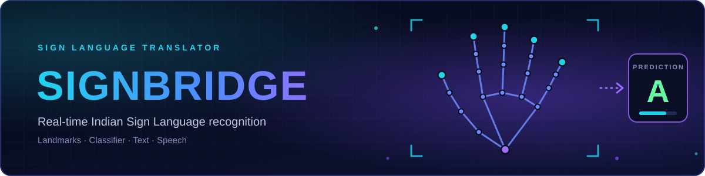
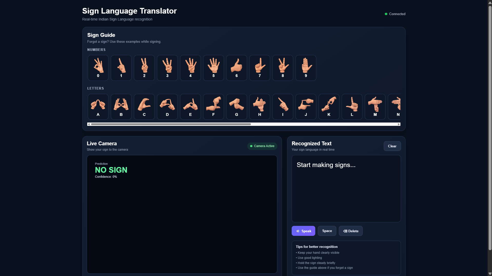
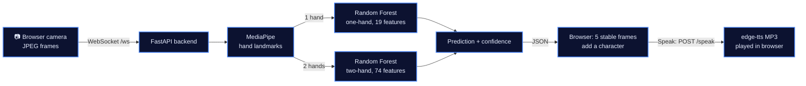

<p align="center">
  
</p>

<p align="center">
  <b>A browser-based translator that recognises Indian Sign Language digits and letters from a webcam and turns them into text and speech.</b>
</p>

<p align="center">
  <a href="https://github.com/Pankaj-Jhajhria/Sign-Language-Translator-Sign-Bridge-">
    
  </a>
  <br>
  <sub>Private repository: access is required to view the source.</sub>
</p>

<p align="center">
  <code>Python</code> <code>FastAPI</code> <code>MediaPipe</code> <code>scikit-learn</code> <code>OpenCV</code> <code>WebSocket</code> <code>JavaScript</code>
</p>

## Application Preview

<p align="center">
  
</p>

<p align="center"><sub>The interface: a sign guide, the live camera panel with the current prediction, and the recognised-text panel with Speak, Space, Delete and Clear controls.</sub></p>

## Core Features

| ✋ **Sign recognition** | 🔀 **One-hand and two-hand models** |
|:---|:---|
| Classifies static digit and letter signs from hand landmarks. | Picks the model by how many hands are in the frame. |

| 📷 **Live camera input** | 🔊 **Text and speech** |
|:---|:---|
| The browser streams webcam frames to the backend over a WebSocket. | Builds text from stable predictions, then speaks it with `edge-tts`. |

## System Architecture



Landmarks are extracted on the backend by a MediaPipe hand landmarker. Predictions below 0.40 confidence, or frames without exactly one or two hands, count as `NO SIGN`. The browser appends a character only after five identical predictions in a row, and the backend generates the speech audio.

## Technology Stack

| Layer | Technologies |
|:---|:---|
| **Backend** | `Python` `FastAPI` `Uvicorn` `WebSocket` |
| **Vision & ML** | `MediaPipe` hand landmarker · `OpenCV` · `NumPy` · `scikit-learn` Random Forest · `joblib` |
| **Frontend** | `HTML` `CSS` `JavaScript` · browser camera API |
| **Speech** | `edge-tts` (voice `en-IN-PrabhatNeural`), played in the browser |

## Run Locally

**Prerequisites:** Python, a webcam, and an internet connection for speech. The repository must contain `Model/one_hand_structure.pkl`, `Model/two_hand_structure.pkl`, `models/hand_landmarker.task`, `symbols/` (sign guide images) and `frontend/`.

**1. Install once** (PowerShell, from the repository root):

```powershell
python -m venv .venv
.venv\Scripts\Activate.ps1
python -m pip install -r requirements.txt
```

The bundled `.pkl` models were saved with **scikit-learn 1.9.0**. Install that version to avoid pickle version warnings.

**2. Start the app** (one terminal, from the repository root):

```powershell
python -m uvicorn backend.main:app --reload
```

**3. Open** [http://127.0.0.1:8000](http://127.0.0.1:8000) and allow camera access.

> **One server, not two.** The FastAPI backend serves the page (`/`), its files (`/static`, `/symbols`), the WebSocket (`/ws`) and `/speak`, and the browser code requests all of them from the same address. A separate static server, such as `python -m http.server 5500 --directory frontend`, cannot provide `/ws` or `/speak`, so the app would not work.

Model paths are relative to the working directory, so always start the server from the repository root. `Model/` and `models/` differ only by letter case, so on Linux and macOS both folders must exist.

## Project Status and Limitations

- **Working:** the full path from camera to landmarks, classifier, text and speech.
- **Static signs only:** each frame is classified on its own, with no model of motion or continuous signing.
- **Letter R:** the bundled two-hand model has no class for `R`, although the sign guide lists it.
- **No published accuracy:** no benchmark results are included.
- **Speech needs internet** because `edge-tts` uses an online service.
- **Local use:** there is no public deployment.
- **Training:** the scripts in `src/` (`clean_dataset.py`, `extract_landmarks_data2.py`, `train_structure.py`) need the image dataset, which is not included.

<p align="center"><sub>Built by <b>Pankaj</b> · <a href="https://github.com/Pankaj-Jhajhria/Sign-Language-Translator-Sign-Bridge-">Sign-Language-Translator-Sign-Bridge-</a></sub></p>
